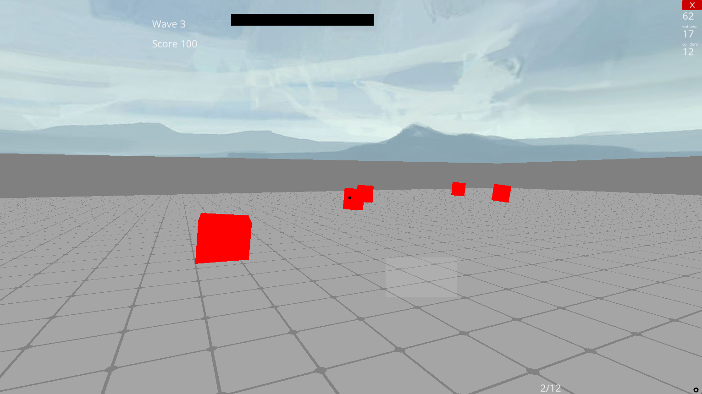

# Autonomous Spatial Vector Projectile Simulation

A first-person 3D survival simulator developed in Python using the Ursina Engine. The system demonstrates real-time agent pathfinding, projectile physics, state management, and dynamic difficulty scaling within a confined spatial environment.

---

## 🎮 Simulation View



---

## 📝 Abstract

This project is a practical implementation of a first-person entity simulation. A player-controlled agent navigates a bounded environment while engaging hostile, autonomous agents (enemies). The system employs a finite state machine for weapon management, spatial calculations for enemy tracking, and real-time UI rendering for telemetry (health, ammunition, and score).

---

## ⚙️ Core Systems & Architecture

- **Entity-Component Architecture:** Built on the Ursina Engine's entity system, separating physical collisions, models, and textures.
- **Agent AI & Pathfinding:** Autonomous agents use vector mathematics to compute real-time normalized direction vectors toward the player entity.
- **Combat State Machine:** The weapon system (`Gun` class) implements a cooldown state, an ammunition state, and an asynchronous reload state that prevents firing during the reload animation.
- **Projectile Physics:** Projectiles are instantiated with velocity vectors and life-spans, using sphere-casting for collision detection against hostile entities.
- **Dynamic Difficulty Scaling:** An exponential growth function increases the number of hostile agents per wave, testing system performance under load:

  ```python
  enemy_count = ENEMY_COUNT_BASE * ENEMY_GROWTH ** (wave - 1)
  ```

---

## 🛠️ Technical Stack

| Area         | Tools                                                  |
|--------------|--------------------------------------------------------|
| Language     | Python 3                                               |
| Engine       | Ursina Engine (Panda3D wrapper)                        |
| Mathematics  | Linear algebra (vector normalization, distance calculations) |

---

## 🚀 Execution Instructions

**1. Clone the repository**

```bash
git clone https://github.com/yourusername/spatial-vector-combat-simulation.git
cd spatial-vector-combat-simulation
```

**2. Initialize a virtual environment**

```bash
python -m venv venv

# Windows
venv\Scripts\activate

# Mac/Linux
source venv/bin/activate
```

**3. Install dependencies**

```bash
pip install -r requirements.txt
```

**4. Start the simulation**

```bash
python simulation.py
```

---

## 🕹️ User Input Controls

| System Action             | Input                         |
|---------------------------|-------------------------------|
| Translation (Movement)    | `W` `A` `S` `D`               |
| Orientation (Camera)      | Mouse movement                |
| Fire Projectile           | Left Mouse Button             |
| Modify FOV (Aim)          | Right Mouse Button (hold)     |
| Reload Subsystem          | `R`                           |
| Pause Simulation          | `P`                           |
| Terminate Process         | `Esc`                         |

---

## 📂 Code Structure

| Class        | Responsibility                                                                 |
|--------------|--------------------------------------------------------------------------------|
| `Enemy`      | Autonomous agent managing health, movement vectors, and melee damage execution. |
| `Projectile` | Transient entity managing forward velocity, life-span, and collision validation. |
| `Gun`        | Weapon subsystem managing ammunition logic and fire-rate cooldowns.            |
| `Game`       | Central state manager handling wave generation, telemetry UI, and simulation resets. |
